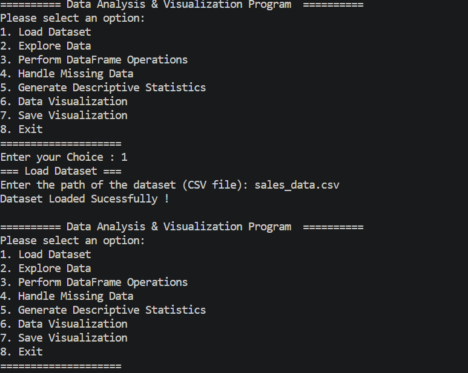

# 📊 PandaS Analyzer & Data Visualization

A Python-based **Sales Data Analysis and Visualization** application that enables users to load CSV datasets, explore data, handle missing values, perform sales calculations, generate descriptive statistics, and visualize sales performance using different types of charts.

Built with **Python, Pandas, NumPy, and Matplotlib**, this project provides an interactive, menu-driven interface for performing essential data analysis tasks efficiently.

## 🚀 Features

### 1. 📂 Load Dataset
- Load sales datasets from CSV files.
- Display a success message after loading.
- Handle invalid file paths and loading errors.

### 2. 🔍 Explore Data
- Display the first five rows of the dataset.
- Display the last five rows of the dataset.
- View column names.
- Check column data types.
- Display dataset information, including rows, columns, and non-null values.

### 3. 📈 DataFrame Operations
- Calculate total sales.
- Display the top five records with the highest sales.
- Display the top five records with the lowest sales.
- Identify the region with the highest total sales.
- Identify the region with the highest total profit.

### 4. 🧹 Handle Missing Data
- Display missing-value counts.
- Fill missing numeric values using column means.
- Drop rows containing missing values.
- Replace missing values with a user-specified value.

### 5. 📊 Statistical Analysis
Generate descriptive statistics for the `Sales` column:
- Minimum sales
- Maximum sales
- Average sales
- Median sales
- Standard deviation of sales

### 6. 📉 Data Visualization
Create different visualizations to explore sales trends and patterns:

- **Bar Chart** — Compare sales across categories.
- **Line Chart** — Analyze sales trends.
- **Scatter Plot** — Examine relationships between variables.
- **Pie Chart** — Visualize proportions across products or categories.
- **Histogram** — Understand the distribution of sales.
- **Stack Plot** — Compare cumulative values across multiple series.

### 7. 💾 Save Visualization
- Save generated charts as image files.
- Support formats such as PNG and JPG, subject to Matplotlib support.
- Save the current visualization for reports and presentations.

## 🛠️ Technologies Used

| Technology | Purpose |
|---|---|
| Python | Core programming language |
| Pandas | Data manipulation and analysis |
| NumPy | Numerical computations |
| Matplotlib | Data visualization |
| Seaborn | Statistical visualization (optional) |

## 📋 Requirements

- Python 3.9 or later recommended
- A CSV dataset containing sales-related data
- pip package manager
- Required Python libraries
- VS code
- Git
- Github

## ⚙️ Installation and Setup

### Step 1: Clone the Repository

```bash
git clone <your-repository-url>
```

Navigate to the project directory:

```bash
cd Sales-Data-Analyzer
```

### Step 2: Install Dependencies

```bash
pip install -r requirements.txt
```

Alternatively, install the dependencies directly:

```bash
pip install pandas numpy matplotlib seaborn
```

### Step 3: Prepare the Dataset

Place your sales dataset in the project directory, or prepare the full path to your CSV file.

Example:

```text
Sales-Data-Analyzer/
├── main.py
├── README.md
├── output.png
└── sales_data.csv
```

### Step 4: Run the Application

```bash
python sales_data_analyzer.py
```

## 💻 How to Use

After running the program, an interactive menu appears:

```text
==================== Data Analysis & Visualization Program ====================

Please select an option:

1. Load Dataset
2. Explore Data
3. Perform DataFrame Operations
4. Handle Missing Data
5. Generate Descriptive Statistics
6. Data Visualization
7. Save Visualization
8. Exit
```

### Example Workflow

1. Select **1 — Load Dataset** to import your CSV file.
2. Select **2 — Explore Data** to inspect the dataset.
3. Select **3 — Perform DataFrame Operations** to calculate sales totals and compare regional performance.
4. Select **4 — Handle Missing Data** to clean incomplete records.
5. Select **5 — Generate Descriptive Statistics** to analyze sales values.
6. Select **6 — Data Visualization** to create charts.
7. Select **7 — Save Visualization** to save the generated chart.
8. Select **8 — Exit** to close the application.


### Example Dataset

```csv
Product,Product_Category,Region,Sales,Profit
Laptop,Electronics,East,1200,250
Phone,Electronics,West,800,150
Desk,Furniture,North,450,90
Chair,Furniture,South,300,60
Tablet,Electronics,East,650,130
```

**Note:** Column names are case-sensitive. Ensure that your CSV column names match those expected by the program. Some operations require specific columns to be present.

## 📊 Example Analysis

Using the dataset, the application can help answer questions such as:

- What is the total sales revenue?
- Which records have the highest and lowest sales?
- Which region generates the most sales?
- Which region generates the highest total profit?
- What are the average and median sales values?
- How are sales distributed across records?
- How do sales compare across products and categories?

## 📦 Project Structure

```text
Sales-Data-Analyzer/
│
├── main.py    
├── README.md           
├── output.png          
└── sales_data.csv               
```

### Output 




## 🎯 Learning Objectives

This project demonstrates practical applications of:

- Python programming and functions
- Pandas DataFrame operations
- Data cleaning and missing-value handling
- Descriptive statistical analysis
- Grouping and aggregation
- Data visualization with Matplotlib
- File handling and exception management
- Building menu-driven command-line applications


## Author
```Adnan```

